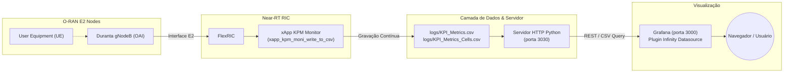

# Open RAN Testbed - Dashboard de Monitoramento FlexRIC no Grafana

Este repositório contém a replicação e automação completa do **Dashboard de Visualização de Informações de Rede e KPIs**, baseado na implementação do [NIST O-RAN-Testbed-Automation](https://github.com/usnistgov/O-RAN-Testbed-Automation/tree/main/OpenAirInterface_Testbed/RAN_Intelligent_Controllers/Flexible-RIC).

O dashboard permite a visualização em tempo real e histórica de métricas de rede (E2SM-KPM) coletadas pelo Near-RT RIC (**FlexRIC**) a partir dos nós E2 (gNodeB e UEs do OpenAirInterface/Duranta).

---

## 📸 Painel de Visualização (Visão Geral)

O dashboard replica exatamente o painel oficial do NIST contendo:
* **Taxa de Transferência (Throughput) de UE (Downlink e Uplink)** (`DRB.UEThpDl`, `DRB.UEThpUl`)
* **Latência de Indicação e Atraso na Camada RLC** (`DRB.RlcSduDelayDl`)
* **Alocação de Blocos de Recursos (PRBs)** (`RRU.PrbTotDl`, `RRU.PrbTotUl`)
* **Distribuição de Esquemas de Modulação e Codificação (MCS)** para 64QAM, 256QAM e Baixa Eficiência Espectral (`CARR.PDSCHMCSDist`)
* **Mapeamento de UEs ativas e evolução temporal de UEs conectadas**


---

## 🏗️ Arquitetura do Sistema



1. **FlexRIC & xApp KPM Monitor**: O xApp inscreve-se nos nós E2 e recebe relatórios periódicos E2SM-KPM (Report Style 4), gravando as métricas em formato CSV (`logs/KPI_Metrics.csv` e `logs/KPI_Metrics_Cells.csv`).
2. **Servidor HTTP Python (porta 3030)**: Disponibiliza os arquivos CSV com suporte a paginação por janela de tempo (`from`/`to`), amostragem e filtragem de colunas via `python_server_for_grafana.py`.
3. **Grafana (porta 3000)**: Consome os dados através do plugin **Infinity Datasource** (`yesoreyeram-infinity-datasource`) e renderiza os gráficos e estatísticas.

---

## 🚀 Como Executar o Dashboard

### 1. Iniciar o Dashboard (Em 1 comando)

Na raiz do repositório, execute:

```bash
./start_dashboard.sh
```

Esse script realiza automaticamente:
- Verificação e instalação do plugin `yesoreyeram-infinity-datasource`.
- Configuração do **provisionamento automático** do Datasource Infinity e do Dashboard `FlexRIC KPI Monitor`.
- Configuração de acesso anônimo com privilégios de Admin (não exige senha nem alteração de credenciais no primeiro acesso).
- Inicialização do servidor Python (porta 3030) e do Grafana (porta 3000).

### 2. Acessar o Dashboard

- **Ambiente Local**: [http://localhost:3000/d/flexric-kpi-monitor/flexric-kpi-monitor](http://localhost:3000/d/flexric-kpi-monitor/flexric-kpi-monitor)
- **GitHub Codespaces**: Abra a aba **Ports (Portas)** no VS Code / Codespaces e clique no ícone de globo na porta **3000** (ou acesse a URL encaminhada `https://<codespace-name>-3000.app.github.dev`).

> As credenciais padrão (caso solicitadas) são:  
> **Usuário:** `admin` | **Senha:** `admin`

---

## 🎯 Modos de Utilização das Métricas

O repositório suporta três formas de visualizar os dados:

### Modo A: Simulação em Tempo Real (Recomendado para Testes)

Se você não estiver executando a rede 5G completa no momento, pode simular o streaming contínuo de dados O-RAN em tempo real:

```bash
python3 simulate_live_traffic.py
```

- Este script injeta métricas reais a cada 1 segundo com o timestamp atual (`now`).
- No Grafana, defina o intervalo de tempo no canto superior direito para **"Last 5 minutes"** e o auto-refresh para **"1s"** ou **"5s"**.
- Os gráficos passarão a se mover e atualizar dinamicamente!

### Modo B: Análise de Dados Históricos / Amostra

O repositório já inclui dados históricos de amostragem gravados durante uma sessão de teste (`sample_KPI_Metrics.csv`):
- No seletor de tempo do Grafana, escolha o intervalo absoluto correspondente aos dados gravados (ex: **26 de Outubro de 2026 das 18:35 às 18:50 UTC**).

### Modo C: Testbed Completo em Produção / Emulação

Para executar o testbed O-RAN real integrado (Open5GS + Duranta gNodeB + UE + FlexRIC + xApp):

```bash
cd O-RAN-Testbed-Automation/OpenAirInterface_Testbed
./run_with_grafana_dashboard.sh
```

---

## 🛑 Como Parar os Serviços

Para encerrar o Grafana, o servidor de métricas Python e o simulador:

```bash
./stop_dashboard.sh
```

---

## 📁 Estrutura de Arquivos Adicionados para Replicação

```text
oran-testbed-test/
├── start_dashboard.sh             # Script principal de inicialização e provisionamento
├── stop_dashboard.sh              # Script para encerrar os serviços
├── simulate_live_traffic.py       # Gerador / replay de tráfego KPM em tempo real
├── grafana/
│   ├── dashboards/
│   │   └── flexric_kpi_monitor.json   # Dashboard pré-configurado com UID do Datasource
│   └── provisioning/
│       ├── dashboards/
│       │   └── dashboards.yaml        # Configuração de carregamento de dashboards
│       └── datasources/
│           └── infinity.yaml          # Configuração do Datasource Infinity (porta 3030)
└── O-RAN-Testbed-Automation/      # Código-fonte oficial do NIST
    └── OpenAirInterface_Testbed/
        └── RAN_Intelligent_Controllers/
            └── Flexible-RIC/
                ├── additional_scripts/ # Scripts e arquivos de dashboard originais
                └── logs/               # Arquivos CSV lidos pelo servidor
```

---

## ⚙️ Configuração Manual (Opcional)

Se preferir configurar o Grafana manualmente sem o provisionamento automático:
1. Instale o plugin: `sudo grafana cli plugins install yesoreyeram-infinity-datasource`
2. No Grafana Web UI: vá em **Connections → Data sources → Add data source → Infinity**.
3. Em **URL, Headers & Params**, defina o **Base URL** como `http://localhost:3030/` e clique em **Save & test**.
4. Vá em **Dashboards → New → Import** e faça upload de `O-RAN-Testbed-Automation/OpenAirInterface_Testbed/RAN_Intelligent_Controllers/Flexible-RIC/additional_scripts/grafana_xapp_dashboard.json`.
